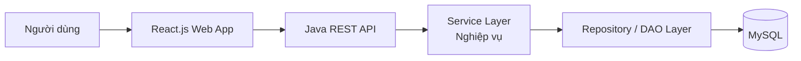

# Kiến trúc hệ thống

## 1. Tổng quan

Business-Management là ứng dụng quản lý thu mua và tồn kho cà phê. Hệ thống
được triển khai theo mô hình **monolith**, trong đó frontend và backend có thể
được phát triển trong cùng repository nhưng vẫn tách biệt trách nhiệm:

- **Frontend:** React.js, cung cấp giao diện quản lý phiếu nhập, chốt giá và
  theo dõi tồn kho.
- **Backend:** Java, cung cấp REST API, xử lý nghiệp vụ và truy cập dữ liệu.
- **Database:** MySQL, lưu trữ nhà cung cấp, mặt hàng, phiếu nhập, chốt giá,
  phiếu xuất và các dữ liệu tài chính liên quan.
- **UI library:** lựa chọn sau; nên thống nhất một thư viện trước khi triển
  khai giao diện để tránh trộn nhiều hệ thống component.

## 2. Mô hình triển khai

Trong môi trường production, frontend có thể được build thành các file tĩnh
và phục vụ bởi web server. Backend Java chạy như một ứng dụng monolith và kết
nối tới một database MySQL. Các thành phần này có thể đóng gói riêng khi
 triển khai nhưng không tách thành các microservice.

## 3. Cấu trúc backend đề xuất

Backend nên tổ chức theo các lớp sau:

1. **Controller:** nhận request HTTP, validate dữ liệu đầu vào và trả response.
2. **Service:** thực hiện quy tắc nghiệp vụ, transaction và kiểm tra điều kiện
   chốt giá.
3. **Repository:** truy vấn và ghi dữ liệu MySQL.
4. **Domain/Entity:** ánh xạ các bảng dữ liệu và các đối tượng nghiệp vụ.
5. **DTO/Mapper:** định nghĩa contract API, không trả trực tiếp entity nội bộ.
6. **Exception handler:** chuẩn hóa lỗi validation, lỗi nghiệp vụ và lỗi hệ
   thống thành response JSON thống nhất.

Các module nghiệp vụ chính:

- `supplier`: nhà cung cấp;
- `user`: người dùng và phân quyền;
- `item`: mặt hàng (ví dụ `Cà phê nhân`) và phân loại (ví dụ `Loại 1`);
- `import`: phiếu nhập kho;
- `price-lock`: chốt giá cho khối lượng đã nhập;
- `inventory`: tổng hợp tồn kho và giá trị tồn kho;
- `export`: phiếu xuất kho (phần mở rộng tiếp theo).

## 4. Luồng nghiệp vụ chính

### Nhập kho

1. Người dùng chọn nhà cung cấp, loại hàng và nhập thông tin khối lượng.
2. Frontend gửi `POST /api/imports`.
3. Backend kiểm tra nhà cung cấp, loại hàng, số bao, từng lần cân, ảnh minh
   chứng và ngày nhập.
4. Backend lưu phiếu nhập trong một transaction.
5. Backend trả về mã phiếu nhập và tổng khối lượng từ các lần cân.

### Chốt giá

1. Người dùng chọn nhà cung cấp và mặt hàng; hệ thống đọc số dư hữu dụng trên nhà cung cấp.
2. Frontend gửi `POST /api/price-locks` với danh sách số dư và khối lượng chốt.
3. Backend khóa `SUPPLIER`, kiểm tra số dư còn lại và trừ
   `usable_coffee_kg` trong cùng transaction.
4. Backend lưu một `PRICE_LOCK` cho một nhà cung cấp và một mặt hàng.
5. Giá trị chốt được dùng để tính giá trị hàng tồn kho.

### Xem tổng quan tồn kho

1. Frontend gửi `GET /api/inventory/summary`.
2. Backend đọc tồn khả dụng từ `ITEM.available_kg`; giá trị có thể âm nếu đã
   xuất theo cam kết.
3. Backend tính giá trị tồn kho dựa trên giá chốt; phần chưa chốt phải được
   trả về riêng để người dùng nhận biết.
4. Frontend hiển thị tổng khối lượng, tổng giá trị và phân loại hàng như
   `Loại 1`, `Loại 2`, `Loại 3`.

## 5. Quyết định và giới hạn phiên bản đầu

- Dùng REST/JSON cho giao tiếp giữa frontend và backend.
- Mọi thay đổi liên quan đến nhập kho và chốt giá phải dùng database
  transaction.
- Số tiền và khối lượng không dùng kiểu số thực nhị phân trong database; nên
  dùng `DECIMAL` để tránh sai số.
- API cần hỗ trợ phân trang cho danh sách phiếu nhập.
- `PRICE_LOCK` liên kết trực tiếp với một `ITEM` và trừ số dư trên nhà cung
  cấp, không phụ thuộc một phiếu nhập cụ thể.
- `EXPORT_TICKET` liên kết trực tiếp với một `ITEM`, cho phép gom hàng từ
  nhiều lần nhập trước khi xuất.
- Quyền thao tác được kiểm tra theo `USER.role_id`/`ROLE.role_name`: `ADMIN`, `WEIGHER`
  hoặc `ACCOUNTANT`.
- Khi nhập/xuất/chốt giá, service phải khóa `SUPPLIER` hoặc `ITEM` liên quan
  trong transaction trước khi cập nhật số dư. Chốt giá phải chặn vượt số dư
  nhà cung cấp; xuất hàng được phép làm tồn kho âm.
- Phân quyền người dùng, audit log, xuất báo cáo và đồng bộ giá thị trường là
  các hạng mục mở rộng, chưa nằm trong phạm vi API tối thiểu này.