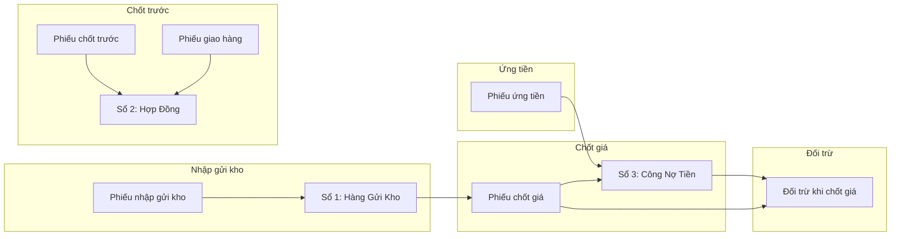

# Business Requirements Document (BRD)

## 1. Tổng quan

### 1.1 Tên hệ thống

**Business-Management - Quản lý thu mua và tồn kho cà phê**

### 1.2 Mục tiêu

- Quản lý thông tin nhà cung cấp, mặt hàng và người dùng.
- Đơn giản hóa tạo phiếu nhập và cân hàng (Mặc định mỗi lần cân là 2 bao ngoài ra là 1 bao)
- Lưu ảnh minh chứng khi cần (ảnh xe chở hàng,...)
- Theo dõi khối lượng đã nhập, số cà phê hữu dụng của từng nhà cung cấp, đã
  chốt giá, đã xuất và còn tồn.
- Cho phép kế toán chốt giá cho số lượng kg và giá mà người bán (nông dân) muốn chốt (Lưu ý: hàng đã nhập kho - có trong kho)
- Hỗ trợ truy xuất phiếu nhập và phiếu xuất.
- Chuẩn hóa quyền thao tác theo vai trò.
- **Quản lý hàng gửi kho (ký gửi chờ chốt giá):** Theo dõi khối lượng hàng
  nông dân/đại lý gửi vào kho nhưng chưa bán, quyền sở hữu vẫn thuộc người gửi.
- **Quản lý chốt giá từ hàng gửi kho:** Cho phép chốt giá một phần hoặc toàn bộ
  số hàng đang gửi, đối trừ tiền ứng trước (nếu có).
- **Quản lý chốt cọc / ứng tiền:** Hỗ trợ cả hai hình thức ứng tiền trên hàng
  đã gửi kho và chốt giá trước – giao hàng sau (hợp đồng bao tiêu).
- **Tách bạch 3 sổ cái (Ledgers):** Sổ Hàng Gửi Kho, Sổ Hợp Đồng/Chốt Trước,
  Sổ Công Nợ Tiền & Lãi — đảm bảo không lẫn lộn giữa các nghiệp vụ.

### 1.3 Phạm vi phiên bản đầu

**Trong phạm vi:**

1. Quản lý người dùng và vai trò.
2. Quản lý nhà cung cấp và mặt hàng.
3. Tạo và tra cứu phiếu nhập/xuất.
4. Ghi nhận từng lần cân, mặc định 2 bao, có thể 1 bao.
5. Chốt giá hàng nhập.
6. Xem tổng hợp tồn kho.
7. Quản lý tồn kho tổng hợp và chi phí theo kỳ.
8.Đăng nhập, đặt lại mật khẩu.
9. Upload ảnh vô dử liệu nhập hàng luôn.
10. Báo cáo doanh thu/lợi nhuận chi tiết.
11. Đồng bộ giá thị trường tự động.
12. **Quản lý hàng gửi kho (ký gửi chờ chốt giá):** Phiếu nhập gửi kho, theo dõi
    số dư hàng gửi theo từng khách hàng.
13. **Chốt giá từ hàng gửi kho:** Chốt giá một phần hoặc toàn bộ, đối trừ tiền
    ứng trước.
14. **Chốt cọc / Ứng tiền (Trường hợp A):** Ứng tiền trên hàng đã gửi kho, tính
    lãi suất tạm ứng, đối trừ khi chốt giá.
15. **Chốt giá trước – Giao hàng sau (Trường hợp B):** Hợp đồng bao tiêu, đặt cọc
    trước, theo dõi tiến độ giao hàng, xử lý giao dư/thiếu.
16. **Hệ thống 3 sổ cái (Ledgers):** Sổ Hàng Gửi Kho, Sổ Hợp Đồng/Chốt Trước,
    Sổ Công Nợ Tiền & Lãi.

### Phạm vi phiên bản kế tiếp

1. Mở rộng dữ liệu phiếu nhập: biển số xe, kho bốc, kho nhập, trừ bì và kết
   quả mẫu thử.
2. Tách màn hình **Thêm dữ liệu** khỏi nghiệp vụ; mặt hàng `ITEM` là dữ liệu
   cà phê nhân cố định, không cho nhập/sửa/xóa từ màn hình này.
3. Quản lý danh sách biển số xe tối giản để người dùng chọn nhanh khi lập
   phiếu nhập; không quản lý thêm thông tin phương tiện.
4. Tìm nhà cung cấp theo CCCD hoặc số điện thoại; nếu không có CCCD thì cho
   phép tìm bằng số điện thoại.
5. Tách màn hình chốt bán và màn hình giao hàng.
6. Hiển thị biểu đồ doanh thu/lợi nhuận theo khoảng ngày được chọn và giá cà
   phê hôm nay lấy từ API.
7. Xuất mẫu phiếu chốt giá và phiếu giao hàng ở dạng thân thiện để in.

### Phạm vi mở rộng (theo ERD mới)

ERD: [erd.mmd](../architecture/erd.mmd). Kế hoạch:
[planning/roadmap.md](../planning/roadmap.md).

1. **Mua:** `PURCHASE_CONTRACT`, `PURCHASE_DELIVERY`.
2. **Bán 3 loại:** `SALES_CONTRACT.contract_type` = `DIRECT`, `LOCKED`,
   `FROM_CONSIGNMENT`; `SALES_DELIVERY`.
3. **Phiếu cân:** `WEIGH_TICKET`, `WEIGH_TICKET_LINE` dùng chung.
4. **Tồn kho:** `WAREHOUSE`, `INVENTORY_TRANSACTION`.
5. **Tiền:** `PAYMENT_VOUCHER`, `PAYMENT_ALLOCATION`, `DEBT_LEDGER`;
   `EXPENSE_CATEGORY`.
6. **Gửi kho:** `CONSIGNMENT_TICKET`, `CONSIGNMENT_BALANCE`,
   `CONSIGNMENT_PRICE_LOCK`, `ADVANCE_PAYMENT`.
7. **Gửi kho khách:** `CUSTOMER_CONSIGNMENT_TICKET`,
   `CUSTOMER_CONSIGNMENT_BALANCE`.
8. **Sổ vay:** `LOAN_CONTRACT`, `LOAN_TRANSACTION`.
9. **Nâng cao:** `REPORT_SCHEDULE`, `ALERT_RULE`.

## 2. Đối tượng sử dụng

| Đối tượng | Nhu cầu chính |
|---|---|
| Admin | Quản trị toàn bộ dữ liệu, người dùng và nghiệp vụ |
| Nhân viên cân | Nhập phiếu và thông tin cân tại chổ mua |
| Kế toán | Theo dõi, chốt giá và xuất hàng |

## 3. Quy trình nghiệp vụ cấp cao

### 3.1 Nhập hàng

1. Nhân viên cân chọn nhà cung cấp và mặt hàng.
2. Tạo phiếu nhập với nhà cung cấp, chọn hoặc thêm nhanh biển số xe, kho bốc,
   kho nhập, trừ bì,
   kết quả mẫu thử, độ ẩm, tạp chất và ngày nhập.
3. Nhập một hoặc nhiều lần cân; mỗi lần cân có `bag_count`(1 hoạc 2 nhưng mặc định là 2).
4. Có thể đính kèm ảnh minh chứng.
5. Hệ thống kiểm tính tổng số bao và tổng khối lượng ->  phiếu nhập.
6. Phiếu chuyển qua các trạng thái `DRAFT`, `CONFIRMED` hoặc
   `CANCELLED`.
7. Sau mỗi lần cân, giao diện hiển thị dòng lần cân và tổng số bao/khối lượng
   lũy kế đến lần đó; lần cuối hiển thị tổng thực tế của phiếu.

### 3.2 Chốt giá

1. Kế toán chọn nhà cung cấp và mặt hàng từ số dư cà phê hữu dụng.
2. Nhập giá chốt và khối lượng chốt.
3. Hệ thống không cho chốt vượt khối lượng còn lại.
4. Hệ thống trừ số dư nhà cung cấp và lưu chi tiết chốt giá.

### 3.3 Xuất hàng

1. Kế toán tạo phiếu bán cho khách hàng.
2. Kế toán ghi nhận khối lượng cam kết bán, giá bán và thông tin lập hóa đơn
   điện tử.
3. Kế toán có thể ghi nhận nhiều lần giao hàng cho cùng một phiếu xuất và chọn
   biển số đã lưu hoặc thêm nhanh biển số.
4. Chỉ khi xác nhận lần giao thực tế, hệ thống mới trừ tồn kho.
5. Hệ thống vẫn cho phép cam kết bán vượt tồn kho hiện tại.
6. Phiếu chuyển sang `PARTIALLY_DELIVERED` khi giao một phần và
   `COMPLETED` khi giao đủ.

### 3.4 Hàng gửi kho (Ký gửi chờ chốt giá)

1. Nông dân hoặc đại lý nhỏ chở cà phê đến nhập vào kho doanh nghiệp nhưng
   **chưa bán ngay** vì chờ giá lên. Quyền sở hữu hàng vẫn thuộc người gửi cho
   đến khi chốt giá.
2. Nhân viên cân tạo phiếu nhập gửi kho với:
   - Mã khách hàng (hộ nông dân / đại lý cấp dưới).
   - Ngày nhập, biển số xe, số phiếu cân.
   - Trọng lượng tổng (cân có bì) → trừ trọng lượng bì → trọng lượng thực tế.
   - Thông số quy chuẩn: độ ẩm (%), tạp chất (%), tỷ lệ đen/vỡ/sâu (%), cỡ
     sàng (R13, R16, R18...).
   - **Trọng lượng quy chuẩn (trọng lượng sạch):** Tính tự động từ trọng lượng
     thực tế sau khi trừ hao hụt độ ẩm và tạp chất vượt chuẩn (ví dụ chuẩn
     12.5% ẩm, 1% tạp chất). *Mọi giao dịch chốt giá sau này đều tính trên
     trọng lượng quy chuẩn này.*
   - Điều khoản lưu kho: phí lưu kho (miễn phí X ngày đầu, sau đó tính
     phí/tấn/tháng), tỷ lệ hao hụt tự nhiên theo thời gian.
3. Hệ thống theo dõi **số dư hàng gửi** theo từng khách:
   - Tổng lượng đã gửi (quy chuẩn).
   - Lượng đã chốt giá (bán đứt cho kho).
   - Lượng đã rút hàng về.
   - **Số dư còn lại = Tổng gửi − Đã chốt − Đã rút.**

### 3.5 Chốt giá từ hàng gửi kho

1. Khi giá cà phê đạt kỳ vọng, khách yêu cầu chốt giá cho một phần hoặc toàn bộ
   số hàng đang gửi.
2. Khách không nhất thiết chốt hết một lần (ví dụ: gửi 10 tấn, hôm nay chốt
   3 tấn giá 115.000đ/kg, tuần sau chốt 7 tấn giá 118.000đ/kg).
3. Phiếu chốt giá lưu:
   - Mã khách hàng, ngày giờ chốt giá (lưu đến phút/giây vì giá biến động
     theo sàn London).
   - Khối lượng chốt: hệ thống kiểm tra không vượt quá *số dư hàng gửi còn
     lại*.
   - Đơn giá chốt tại thời điểm chốt (có thể cộng/trừ biên độ theo chất lượng
     lô hàng).
   - Thành tiền = khối lượng chốt × đơn giá chốt.
4. **Đối trừ (cấn trừ) tạm ứng:** Nếu trước đó khách đã ứng tiền trên lô hàng
   gửi này, hệ thống tự động trừ tiền gốc + lãi suất tạm ứng (nếu có) để ra số
   tiền thực nhận.

### 3.6 Chốt cọc / Ứng tiền

#### Trường hợp A: Ứng tiền trên hàng ĐÃ gửi kho

1. Khách đã có hàng trong kho (chưa chốt giá), cần tiền mặt nên xin ứng trước.
2. Hệ thống quản lý:
   - Hạn mức được ứng (thường tối đa 70%–80% giá trị lô hàng theo giá thị
     trường tại thời điểm ứng).
   - Lãi suất tạm ứng: tính từ ngày ứng tiền đến ngày khách chính thức chốt
     giá (ví dụ: 0.8%/tháng hoặc theo lãi ngân hàng).
3. Khi khách chốt giá → hệ thống tự tính tiền lãi =
   `Số tiền ứng × Lãi suất × Số ngày ứng`, sau đó trừ vào tiền bán hàng.

#### Trường hợp B: Chốt giá trước – Giao hàng sau (Hợp đồng bao tiêu / Chốt non)

1. Chưa đến mùa thu hoạch (hoặc hàng chưa chở tới kho), doanh nghiệp và
   đại lý/nông dân ký thỏa thuận chốt trước khối lượng với giá đã khóa,
   doanh nghiệp chuyển cọc trước.
2. Phiếu chốt trước lưu:
   - Mã hợp đồng / phiếu chốt trước.
   - Khối lượng cam kết, đơn giá đã chốt, hạn chót giao hàng.
   - Số tiền đặt cọc đã chi.
3. **Theo dõi tiến độ giao hàng (mapping nhiều phiếu cân vào 1 phiếu chốt):**
   - Lần 1 giao một phần khối lượng (quy chuẩn) → trừ vào khối lượng cam kết.
   - Lần 2 giao phần còn lại → hoàn thành theo giá chốt cũ.
   - Phần **giao dư** tự động chuyển sang tính theo giá thị trường ngày giao
     hoặc chuyển thành hàng gửi kho mới.
4. **Xử lý vi phạm/giao thiếu:** Nếu đến hạn không giao đủ hàng, hệ thống hỗ
   trợ tính phạt chênh lệch giá (nếu giá thị trường tăng cao hơn giá chốt) hoặc
   thu hồi tiền cọc.

### 3.7 Tổng quan và báo cáo

1. Người dùng chọn khoảng ngày trên màn hình tổng quan.
2. Hệ thống lấy dữ liệu từ API để hiển thị biểu đồ doanh thu và lợi nhuận theo
   ngày, phân biệt số liệu giao thực tế với số cam kết/ước tính.
3. Hệ thống hiển thị giá cà phê trong ngày từ API theo mặt hàng, nguồn và thời
   điểm cập nhật; nếu chưa có giá hôm nay phải thể hiện rõ là chưa có dữ liệu.
4. Tính lợi nhuận theo giao dịch giao đã xác nhận; cách tính giá vốn và việc
   phân bổ chi phí cần được chốt trước khi phát triển.

### 3.8 In chứng từ

1. Màn hình chốt giá cho phép xem bản in mẫu trước khi in.
2. Màn hình giao hàng cho phép xem bản in mẫu của lần giao.
3. Nội dung in lấy từ API, có mã phiếu, đối tác, mặt hàng, khối lượng, đơn giá,
   thành tiền, ngày lập và người thực hiện. Tệp in chỉ đọc dữ liệu đã lưu.

## 4. Yêu cầu chức năng

| Mã | Yêu cầu |
|---|---|
| BR-001 | Hệ thống quản lý nhà cung cấp, gồm tên, mã định danh, điện thoại và địa chỉ. |
| BR-002 | Hệ thống quản lý mặt hàng như `Cà phê nhân`, phân loại như `Loại 1`. |
| BR-003 | Người dùng có vai trò `ADMIN`, `WEIGHER` hoặc `ACCOUNTANT`. |
| BR-004 | Tạo phiếu nhập với số bao, tổng kg, độ ẩm, tạp chất, ảnh tùy chọn và ghi chú. |
| BR-005 | Một phiếu nhập có nhiều bản ghi `IMPORT_WEIGHT`. |
| BR-006 | Một lần cân được ghi nhận cho 1 hoặc 2 bao. |
| BR-007 | Một lần chốt giá trừ số dư cà phê hữu dụng của nhà cung cấp, không phụ thuộc phiếu nhập cụ thể. |
| BR-008 | Một số dư nhà cung cấp có thể được chốt nhiều lần cho đến khi hết số dư. |
| BR-009 | Hiển thị tổng nhập, đã chốt, chưa chốt và tồn kho. |
| BR-010 | Phiếu xuất lưu cam kết bán; các lần giao thực tế được lưu riêng và chỉ trừ tồn kho khi xác nhận giao. |
| BR-011 | Lưu người tạo và thời điểm tạo/cập nhật cho các nghiệp vụ chính. |
| BR-012 | Nhà cung cấp được tìm theo `identity_no` hoặc `phone`; khi không có CCCD thì số điện thoại là khóa tìm kiếm thay thế. |
| BR-013 | `VEHICLE` chỉ lưu biển số xe duy nhất và trạng thái hoạt động; phiếu nhập và phiếu giao có thể tham chiếu xe đã chọn, đồng thời lưu snapshot biển số tại thời điểm giao dịch. |
| BR-014 | `ITEM` vẫn tồn tại để liên kết tồn kho và giá thị trường nhưng không xuất hiện trong màn hình **Thêm dữ liệu** phiên bản kế tiếp. |
| BR-015 | Biểu đồ doanh thu/lợi nhuận nhận `fromDate`, `toDate` và tùy chọn mặt hàng từ API. |
| BR-016 | Giá cà phê hôm nay được lấy từ `MARKET_PRICE` theo mặt hàng và `price_date`; không dùng giá nhập tay trên frontend làm dữ liệu chính. |
| BR-017 | Màn hình bán và màn hình giao là hai luồng giao diện riêng nhưng vẫn dùng chung `EXPORT_TICKET` và `EXPORT_DELIVERY`. |
| BR-018 | Bản in chốt giá và giao hàng là dữ liệu trình bày từ API, không tạo giao dịch mới và không thay đổi số dư; người dùng có thể xem trước và xuất/in PDF. |
| BR-019 | **Thêm dữ liệu** không cho tạo/sửa/xóa `ITEM`; `ITEM` vẫn được dùng nội bộ cho cà phê nhân, tồn kho và giá thị trường. |
| BR-020 | Biểu đồ lấy ngày giao đã xác nhận làm mốc ghi nhận đề xuất; doanh thu/lợi nhuận phải tách khỏi giá trị ước tính của phiếu bán và chờ duyệt công thức giá vốn/chi phí. |
| BR-021 | API dashboard trả giá hôm nay theo `MARKET_PRICE`, có nguồn và thời điểm; không giả làm giá hôm nay nếu dữ liệu hiện hành chưa có. |
| BR-022 | **Hàng gửi kho:** Phiếu nhập gửi kho lưu mã khách hàng, ngày nhập, biển số xe, số phiếu cân, trọng lượng có bì, trọng lượng bì, trọng lượng thực tế, thông số quy chuẩn (độ ẩm, tạp chất, tỷ lệ đen/vỡ/sâu, cỡ sàng), và **trọng lượng quy chuẩn** tính tự động. |
| BR-023 | **Trọng lượng quy chuẩn** = trọng lượng thực tế − (hao hụt độ ẩm vượt chuẩn + hao hụt tạp chất vượt chuẩn). Mọi giao dịch chốt giá sau này tính trên trọng lượng quy chuẩn. |
| BR-024 | **Điều khoản lưu kho:** Phí lưu kho miễn phí X ngày đầu, sau đó tính phí/tấn/tháng; tỷ lệ hao hụt tự nhiên theo thời gian (nếu có). |
| BR-025 | **Số dư hàng gửi theo khách:** Hệ thống theo dõi tổng đã gửi, đã chốt, đã rút, và số dư còn lại = tổng gửi − đã chốt − đã rút. |
| BR-026 | **Chốt giá từ hàng gửi kho:** Phiếu chốt giá lưu mã khách hàng, ngày giờ chốt (đến phút/giây), khối lượng chốt, đơn giá chốt, thành tiền. Khối lượng chốt không vượt số dư hàng gửi còn lại. |
| BR-027 | **Đối trừ tạm ứng khi chốt giá:** Nếu khách đã ứng tiền trên lô hàng gửi, hệ thống tự động trừ tiền gốc + lãi suất tạm ứng để ra số tiền thực nhận. |
| BR-028 | **Ứng tiền trên hàng đã gửi kho (Trường hợp A):** Hệ thống quản lý hạn mức ứng (tối đa 70%–80% giá trị lô hàng theo giá thị trường), lãi suất tạm ứng tính từ ngày ứng đến ngày chốt giá. |
| BR-029 | **Chốt giá trước – Giao hàng sau (Trường hợp B):** Phiếu chốt trước lưu mã hợp đồng, khối lượng cam kết, đơn giá đã chốt, hạn chót giao hàng, số tiền đặt cọc. |
| BR-030 | **Tiến độ giao hàng theo phiếu chốt trước:** Hệ thống mapping nhiều phiếu cân vào 1 phiếu chốt, trừ dần khối lượng cam kết. Phần giao dư tự động chuyển sang giá thị trường ngày giao hoặc thành hàng gửi kho mới. |
| BR-031 | **Xử lý vi phạm/giao thiếu:** Hệ thống hỗ trợ tính phạt chênh lệch giá hoặc thu hồi tiền cọc khi đến hạn không giao đủ. |
| BR-032 | **Sổ Hàng Gửi Kho (Ledger 1):** Theo dõi lượng hàng vật lý khách đang gửi tại kho (kg quy chuẩn), gồm nhập gửi − chốt giá − rút lại. |
| BR-033 | **Sổ Hợp Đồng/Chốt Trước (Ledger 2):** Theo dõi lượng hàng khách cam kết giao cho kho theo giá đã khóa (kg quy chuẩn), gồm cam kết − đã giao. |
| BR-034 | **Sổ Công Nợ Tiền & Lãi (Ledger 3):** Theo dõi tiền mặt đã ứng/cọc, tiền lãi phát sinh theo ngày, và tiền hàng đã chốt giá phải trả khách (VNĐ). |

## 5. Yêu cầu phi chức năng

- Backend Java, frontend React.js, database MySQL.
- Giao tiếp bằng REST/JSON.
- Dữ liệu tiền và khối lượng dùng kiểu chính xác (`DECIMAL`).
- Các thao tác nhập, chốt giá và xuất phải có transaction.
- Kiểm tra quyền ở backend, không chỉ ở giao diện.
- Không để một request làm tổng chốt vượt số cà phê hữu dụng của nhà cung cấp.
- Cho phép tồn kho mặt hàng âm khi đã phát sinh cam kết xuất vượt số đang có.
- Theo dõi riêng khối lượng đã cam kết, đã giao và còn phải giao.
- **3 sổ cái (Ledgers) phải tách bạch:** Sổ Hàng Gửi Kho (kg quy chuẩn),
  Sổ Hợp Đồng/Chốt Trước (kg quy chuẩn), Sổ Công Nợ Tiền & Lãi (VNĐ) — không
  dùng chung một bảng công nợ cho cả ba mục đích.
- **Trọng lượng quy chuẩn** phải được tính tự động từ trọng lượng thực tế và
  thông số quy chuẩn (độ ẩm, tạp chất); không nhập tay.
- **Lãi suất tạm ứng** phải được tính theo ngày thực tế (ngày ứng đến ngày
  chốt), không làm tròn tháng.
- **Ngày giờ chốt giá** phải lưu đến phút/giây để phục vụ đối chiếu biến động
  giá thị trường.

## 6. Tiêu chí thành công

- Nhân viên cân tạo được phiếu với dữ liệu các lần cân hợp lệ.
- Kế toán chốt đơn và xuất đơn. 
- Hệ thống từ chối chốt vượt số lượng còn hữu dụng nhưng xuất thì được vì có thể hôm đó chưa giao cho khách hàng (Là các công ty chế biến) được ngay vì thể có thể tự cam kết khi người dân có thể bán cho mình đủ số lượng đó trong 3 tới 5 ngày chẳng hạn.
- Người dùng xem được tồn kho và trạng thái phiếu rõ ràng.
- Hàng xuất được gom từ tồn kho tổng hợp theo mặt hàng; không bắt buộc gắn
  trực tiếp với một phiếu nhập nguồn.
- Hóa đơn điện tử có thể dựa trên `EXPORT_TICKET`; số lượng giao thực tế được
  đối chiếu qua các bản ghi `EXPORT_DELIVERY`.
- Biểu đồ doanh thu/lợi nhuận phiên bản kế tiếp ưu tiên số liệu giao hàng đã
  xác nhận; cách tính theo ngày lập phiếu bán hay ngày giao phải được chốt
  trước khi triển khai.
- Giao diện nhập phải cho phép thêm biển số mới và chọn lại biển số đang hoạt
  động bằng danh sách dropdown/toggle list; không yêu cầu nhập lại biển số
  trong mỗi phiếu.
- Giao diện giao hàng cũng dùng danh sách biển số dùng lại theo ERD; mỗi phiếu
  giữ snapshot biển số để lịch sử không đổi sau khi biển số bị ẩn/cập nhật.
- Trước khi phát triển các trường tính khấu trừ trong ERD, phải xác nhận đơn vị
  `tare_weight`, bảng khấu trừ độ ẩm/tạp chất, cách tính khối lượng tính tiền
  và xử lý độ ẩm ngoài dải.
- **Hàng gửi kho:** Khách gửi 10 tấn, chốt 3 tấn, rút 2 tấn → hệ thống hiển
  thị đúng số dư còn lại 5 tấn (quy chuẩn).
- **Chốt giá từ hàng gửi:** Hệ thống tự động đối trừ tiền ứng + lãi khi chốt
  giá, hiển thị số tiền thực nhận chính xác.
- **Chốt cọc / Ứng tiền:** Trường hợp A tính đúng lãi suất theo ngày; Trường
  hợp B theo dõi đúng tiến độ giao hàng và xử lý giao dư/thiếu.
- **3 sổ cái hoạt động độc lập:** Sổ Hàng Gửi Kho, Sổ Hợp Đồng, Sổ Công Nợ
  không lẫn lộn dữ liệu; mỗi nghiệp vụ chỉ cập nhật đúng sổ của nó.

## 7. Các quyết định ngoài ra: 

1. `photo_url` không bắt buộc.
2. `total_kg` do hệ thống tính từ `IMPORT_WEIGHT`.
3. Sau khi `CONFIRMED`, chỉ kế toán được sửa; nhân viên cân phải liên hệ kế
   toán.
4. Mỗi `PRICE_LOCK` áp dụng cho một mặt hàng và một nhà cung cấp.
5. Hệ thống chỉ quản lý một kho.
6. Số cà phê hữu dụng tính bằng tổng khối lượng nhập.
7. Chi phí được cập nhật trực tiếp tổng tiền
   của danh mục các chi phí con (từ ngày đến ngày)?
8. **Hàng gửi kho** và **hàng nhập mua đứt** là hai nghiệp vụ riêng biệt:
   hàng gửi kho chưa chuyển quyền sở hữu, hàng nhập mua đứt đã chuyển quyền
   sở hữu ngay khi nhập.
9. **Trọng lượng quy chuẩn** là cơ sở tính tiền duy nhất cho hàng gửi kho;
   trọng lượng thực tế chỉ dùng để đối chiếu cân.
10. **Chốt giá từ hàng gửi kho** không trộn với chốt giá hàng nhập mua đứt;
    hai nghiệp vụ dùng `PRICE_LOCK` riêng theo loại.
11. **Ứng tiền trên hàng gửi kho** phải gắn với lô hàng gửi cụ thể, không ứng
    tràn lan trên tổng số dư.
12. **Chốt giá trước – Giao hàng sau** không ảnh hưởng đến tồn kho cho đến khi
    giao hàng thực tế; chỉ ảnh hưởng đến Sổ Hợp Đồng.
13. **Tiền cọc** trong hợp đồng bao tiêu được theo dõi riêng, không trộn với
    tiền ứng trên hàng gửi kho.

## 8. Kiến trúc dữ liệu cốt lõi — 3 Sổ cái (Ledgers)

Để không bị rối, hệ thống tách rõ **3 sổ cái (Ledgers)** độc lập cho mỗi khách
hàng thay vì chỉ có 1 bảng công nợ chung:

| Sổ theo dõi | Đơn vị tính | Mục đích |
|---|---|---|
| **1. Sổ Hàng Gửi Kho** | Kg (Quy chuẩn) | Theo dõi lượng hàng vật lý khách đang gửi tại kho (Nhập gửi − Chốt giá − Rút lại). |
| **2. Sổ Hợp Đồng / Chốt Trước** | Kg (Quy chuẩn) | Theo dõi lượng hàng khách cam kết giao cho kho theo giá đã khóa (Cam kết − Đã giao). |
| **3. Sổ Công Nợ Tiền & Lãi** | VNĐ | Theo dõi tiền mặt đã ứng/cọc, tiền lãi phát sinh theo ngày, và tiền hàng đã chốt giá phải trả khách. |

### 8.1 Nguyên tắc thiết kế

- Mỗi khách hàng có thể có cả 3 sổ cùng lúc, nhưng dữ liệu độc lập.
- Sổ 1 và Sổ 2 dùng **kg quy chuẩn**; Sổ 3 dùng **VNĐ**.
- Không trộn lẫn nghiệp vụ: nhập gửi kho chỉ cập nhật Sổ 1; chốt giá trước chỉ
  cập nhật Sổ 2; ứng tiền/cọc chỉ cập nhật Sổ 3.
- Khi chốt giá từ hàng gửi kho: trừ Sổ 1, cộng Sổ 3 (tiền phải trả khách).
- Khi giao hàng theo hợp đồng: trừ Sổ 2, không ảnh hưởng Sổ 1.
- Khi đối trừ tạm ứng: trừ Sổ 3 (giảm tiền phải trả khách).

### 8.2 Luồng dữ liệu giữa các sổ

